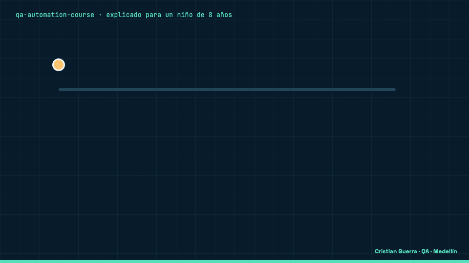

[Read in English](README.md)


## Explicado para un niño de 8 años

Este es un curso que enseña a revisar que los programas de computador funcionen. Es un camino con cuatro paradas, desde lo básico hasta revisar robots que escriben respuestas. En cada parada hay un examen corto que se corrige solo y una tarea con una lista de “lo logré si…”. La idea grande es como revisar que un guardia esté despierto: haces un ruido a propósito y miras si grita. Si se queda callado, estaba dormido, y eso es lo que anotas.

**Un ejemplo real de este repo**

- **Imagina** que el curso tiene 429 preguntas de quiz y cada una dice cuál es la respuesta buena.
- **Qué pasa:** dañamos una pregunta a propósito. Tiene 4 respuestas y dijimos que la buena era la número 9, que no existe.
- **Qué hace el proyecto:** un robot revisor, `scripts/check-course.mjs`, lee todas las preguntas. Encontró la dañada, dijo “1 problema” y terminó con código de salida 1. El workflow de Pages corre ese robot antes de publicar, así que un quiz dañado no sale.
- **Qué ganamos:** sabemos que el robot está despierto, porque lo vimos atrapar un error que pusimos nosotros.



[Versión MP4](docs/assets/explained.es.mp4) · fuente: [`docs/scenes/explained.html`](docs/scenes/explained.html)

| Palabra difícil | Qué significa |
|---|---|
| Prueba (test) | Una pregunta de la que ya sabemos la respuesta, para comprobar que un programa funciona |
| Quiz | Un examen corto dentro del curso que se califica solo mientras respondes |
| Rúbrica | Una tabla que dice cómo se ve “todavía no”, “casi”, “aprobado” y “excelente” |
| Mutante | Una copia del programa con una cosa dañada a propósito, para ver si las pruebas lo notan |
| Pipeline (CI) | Un robot que corre todas las revisiones cada vez que alguien entrega un cambio |
| localStorage | Una cajita dentro de tu navegador donde el curso recuerda tu avance |

<p>
  
  
  
  
  
  
</p>

## Qué es

Un curso gratis e interactivo que te lleva de lo básico de QA al trabajo que hago hoy: QA asistida por IA con una persona que firma, ejecución de mutantes, evaluación de LLM y agentes, pipelines y contenedores efímeros, y QA científico (prerregistro, huellas, reproducibilidad). Es una sola página estática, sin build ni servidor. Tiene 35 módulos en cuatro niveles (fundamentos, intermedio, AI-QA avanzado y QA científico) y un proyecto final. El hilo de todo es el WAR Paradigm: **prueba al que prueba, muta la realidad**. Cada módulo termina con una “mutación de la semana”, en la que dañas a propósito tu propio chequeo y muestras que lo nota.

## Cómo funciona


Todos los módulos tienen las mismas partes:

- **Objetivos** (“al terminar puedes…”) y **prerrequisitos**.
- **Teoría corta y un laboratorio.** En los módulos nuevos, el laboratorio es uno de mis repos públicos.
- **Un quiz autocorregible:** 8 preguntas al azar del banco del módulo, una respuesta por pregunta y la explicación después de cada respuesta. Apruebas con 6 de 8. Cada intento saca otras preguntas.
- **Un reto con criterios de aprobación verificables** con un comando o una captura, por ejemplo “tu suite mata al menos 5 de 6 mutantes y el reporte JSON trae hashes” o “tu juez tiene un kappa ≥ 0,6 contra tus etiquetas”.
- **Una rúbrica de 4 niveles** (no cumple · en camino · aprobado · sobresaliente). Los módulos más nuevos usan una rúbrica de cuatro filas, una por habilidad, y aprobar es tener todas las filas en el nivel 3.
- **Una línea “explicado para un niño de 8 años”** y la **mutación de la semana**.

Un módulo queda aprobado con el quiz en 6/8 o más y el reto en el nivel 3 de la rúbrica. El examen final tiene 26 preguntas y pide 80 %. El capstone, una auditoría WAR de un sistema real, tiene una rúbrica integrada de los tres ejes, y solo se aprueba cuando otra persona reproduce tu paquete en un entorno limpio y obtiene la misma huella. Las reglas completas están en la página [Cómo te evalúas](evaluacion.html).

Una corrida real del sitio, grabada con Playwright: abrir un módulo, responder una pregunta bien y otra mal, terminar el quiz, marcar el entregable y ver el nodo en verde en el mapa.


[Versión MP4](docs/assets/course-run.mp4) · grabada con [`docs/scenes/record-course.mjs`](docs/scenes/record-course.mjs)

## La ruta


| # | Nivel | Módulo | Repos de laboratorio |
|---|---|---|---|
| 01 | Nivel 1 · Fundamentos | Mentalidad QA — de Dev a Tester | [war-paradigm](https://github.com/criguex/war-paradigm) |
| 02 |  | WAR Paradigm — probar al que prueba, mutar la realidad | [war-paradigm](https://github.com/criguex/war-paradigm), [scientific-qa-evidence](https://github.com/criguex/scientific-qa-evidence) |
| 03 |  | Diseño de pruebas & técnicas | — |
| 04 |  | Setup día 0 — el entorno | — |
| 05 |  | Obsidian — tu segundo cerebro (Fase 0 del método) | — |
| 06 |  | TypeScript para QA | — |
| 07 |  | Playwright + TypeScript E2E — framework desde cero | — |
| 08 |  | API & Contract Testing — tu especialidad futura | [restful-booker-quality-suite](https://github.com/criguex/restful-booker-quality-suite), [civica-playwright-challenge](https://github.com/criguex/civica-playwright-challenge) |
| 09 |  | BDD — Gherkin, Cucumber & Serenity | — |
| 10 |  | Ejecución disciplinada — ciclos, test data & known issues | — |
| 11 | Nivel 2 · Intermedio | Reportes & Trazabilidad — evidencia que se puede firmar | — |
| 12 |  | Sign-off / Certificación de una historia — el cierre del método | — |
| 13 |  | CI/CD & Docker | — |
| 14 |  | Pipelines — anatomía, gates, qué significa un verde y pipelines de evidencia | [civica-playwright-challenge](https://github.com/criguex/civica-playwright-challenge), [qa-eval-lab](https://github.com/criguex/qa-eval-lab), [restful-booker-quality-suite](https://github.com/criguex/restful-booker-quality-suite), [predictor-debugger](https://github.com/criguex/predictor-debugger) |
| 15 |  | Contenedores efímeros y entornos desechables — que la evidencia sobreviva al entorno | [predictor-debugger](https://github.com/criguex/predictor-debugger) |
| 16 |  | Performance & Cloud (K6 · JMeter · AWS) | — |
| 17 |  | Determinismo — mocks, record/replay y fixtures indexados por hash | [playwright-jev](https://github.com/criguex/playwright-jev), [civica-playwright-challenge](https://github.com/criguex/civica-playwright-challenge) |
| 18 |  | QA Aumentado con IA — mi diferenciador | — |
| 19 |  | QA asistida por IA I — el asistente prueba, la persona firma | [war-paradigm](https://github.com/criguex/war-paradigm) |
| 20 |  | Mutation testing — kill rate, sobrevivientes y Stryker/PIT | [war-paradigm](https://github.com/criguex/war-paradigm), [scientific-qa-evidence](https://github.com/criguex/scientific-qa-evidence) |
| 21 |  | Ejecución de mutantes — generar, correr, clasificar y aprender de cada corrida | [war-paradigm](https://github.com/criguex/war-paradigm), [civica-playwright-challenge](https://github.com/criguex/civica-playwright-challenge) |
| 22 |  | Mutantes que aprenden — ledger, priorización y mutantes que miden al auditor | [civica-playwright-challenge](https://github.com/criguex/civica-playwright-challenge) |
| 23 |  | Triaje de fallos de CI y selección de pruebas por impacto | [jev-ci-triage](https://github.com/criguex/jev-ci-triage), [jev-test-impact](https://github.com/criguex/jev-test-impact) |
| 24 | Nivel 3 · AI-QA avanzado | Evaluar IA con un LLM como juez — DeepEval, Promptfoo, umbrales y falsos verdes | [qa-eval-lab](https://github.com/criguex/qa-eval-lab) |
| 25 |  | Calibrar un juez y evaluar agentes de IA — chequeos de código, kappa de Cohen y revisión humana en la zona gris | [agent-eval-jev](https://github.com/criguex/agent-eval-jev), [qa-eval-lab](https://github.com/criguex/qa-eval-lab) |
| 26 |  | Jueces con probabilidad — modos de falla, estabilidad y cascadas | [war-paradigm](https://github.com/criguex/war-paradigm), [laya-server](https://github.com/criguex/laya-server), [playwright-jev](https://github.com/criguex/playwright-jev), [jev-ci-triage](https://github.com/criguex/jev-ci-triage) |
| 27 |  | QA asistida por IA II — el asistente diseña, ejecuta y audita; una persona firma | [war-paradigm](https://github.com/criguex/war-paradigm), [scientific-qa-evidence](https://github.com/criguex/scientific-qa-evidence) |
| 28 | Nivel 4 · QA científico | Prerregistro y reproducibilidad — umbrales antes de los datos y la misma huella en otra máquina | [predictor-debugger](https://github.com/criguex/predictor-debugger) |
| 29 |  | QA de requisitos — revisar la spec antes de construir | [spec-review-case-study](https://github.com/criguex/spec-review-case-study) |
| 30 |  | Controles, arnés y mutación numérica — contrato congelado y oráculo independiente | [scientific-qa-evidence](https://github.com/criguex/scientific-qa-evidence), [war-paradigm](https://github.com/criguex/war-paradigm) |
| 31 |  | Física de fluidos y estadística para el depurador | [predictor-debugger](https://github.com/criguex/predictor-debugger) |
| 32 |  | Verificar una prueba formal sin ser matemático — recompilar, checkers independientes y enunciados mutados | [scientific-qa-evidence](https://github.com/criguex/scientific-qa-evidence) |
| 33 |  | Prueba a ciegas con compromiso por hash — que quien prueba no conozca las trampas | [predictor-debugger](https://github.com/criguex/predictor-debugger), [scientific-qa-evidence](https://github.com/criguex/scientific-qa-evidence) |
| 34 | Cierre · proyecto final | Capstone «Auditoría WAR» — una auditoría que otra persona reproduce en un entorno limpio | [war-paradigm](https://github.com/criguex/war-paradigm), [predictor-debugger](https://github.com/criguex/predictor-debugger), [scientific-qa-evidence](https://github.com/criguex/scientific-qa-evidence) |
| 35 |  | Tu carrera QA+IA — posicionamiento | — |

Tres formas de recorrerla: la ruta completa desde cero (unas 37 semanas a 10–12 h por semana), una de 20 semanas si ya automatizas pruebas de UI o API, y una de 12 semanas. La de 20 semanas, con el número de módulo de cada semana:


La de 12 semanas está en la página [Cómo te evalúas](evaluacion.html).

## Cómo correrlo

```bash
git clone https://github.com/criguex/qa-automation-course.git && cd qa-automation-course
python3 -m http.server 8080        # abre http://localhost:8080
node scripts/check-course.mjs      # valida cada módulo y cada pregunta
```

`check-course.mjs` (Node 18+, sin dependencias) comprueba que cada módulo tenga objetivos, prerrequisitos, explicación para niños, laboratorio, criterios, rúbrica y mutación de la semana, que cada banco de quiz tenga al menos 8 preguntas y que cada respuesta apunte a una opción que existe. Hoy imprime `35 modules · 4 levels + final project` y `429 quiz questions · 0 problems`.

Puedes entrar con Google o como invitado. Como invitado, tu avance, tu mejor puntaje en cada quiz y el del examen viven solo en tu navegador (`localStorage`). Con tu cuenta se guardan en Firestore bajo tu id de usuario y sigues desde cualquier dispositivo; al iniciar sesión, lo que hiciste como invitado se suma a tu cuenta (un módulo queda marcado si está marcado en cualquiera de los dos lados, y ganan los mejores puntajes de quiz y de examen).

## Entrar con Google (Firebase)

El login y el avance en la nube usan la config web de Firebase del proyecto `curso-qa`, que está en `index.html` (la apiKey web de Firebase es pública por diseño; el acceso lo controlan las reglas de abajo). Para que funcione en el sitio publicado, en la consola de Firebase hace falta:

1. **Authentication → Sign-in method → Google** activado.
2. **Authentication → Settings → Authorized domains:** agregar `criguex.github.io` (y `localhost` para probar en local). Mientras el dominio no esté, el botón muestra un aviso que lo explica, y el modo invitado sigue funcionando.
3. **Reglas de Firestore:** las de [`firestore.rules`](firestore.rules), para que cada persona solo pueda leer y escribir su propio documento `progress/{uid}`.

## Publicarlo con GitHub Pages

[`.github/workflows/pages.yml`](.github/workflows/pages.yml) corre `check-course.mjs` y después publica la raíz del repo en GitHub Pages con cada push a `main`. Antes del primer push activa **Settings → Pages → Source: GitHub Actions**; si no, el paso de deploy falla.

## Qué se actualizó (26 de octubre de 2026)

- **Versiones revisadas** con `npm view`, el índice de versiones de Node, Maven Central y los releases de GitHub: Playwright 1.64, TypeScript 7.0, Node 24 LTS, Java 25 LTS, Karate 2.1 y k6 2.3. Los módulos cubren lo que cambió: los defaults y las opciones eliminadas de TypeScript 7, Karate 2 (Java 21+, CLI nueva), k6 2.x (ya no existen `pause/resume/scale/status` ni el executor `externally-controlled`; ahora es `k6 cloud run`) y que `brew install node` instala la versión Current y no la LTS.
- **Enlaces:** se revisaron 158 con `curl -L`; todos respondieron 200 menos cuatro de `doi.org` cuyas editoriales bloquean bots (403 a curl; abren en el navegador). Los que redirigían quedaron con su dirección nueva.
- **Módulos nuevos:** WAR Paradigm, pipelines, contenedores efímeros, determinismo y record/replay, QA asistida por IA I y II, mutation testing, ejecución de mutantes, mutantes que aprenden, triaje de CI e impacto, LLM como juez, calibración del juez y agentes, jueces con probabilidad, prerregistro y reproducibilidad, QA de requisitos, controles y mutación numérica, fluidos y estadística, verificación formal y pruebas a ciegas con compromiso por hash.
- **Un caso WAR real dentro del curso:** una mutación encontró dos agujeros en el hook de war-paradigm que bloquea el push a main (`git -c` y `git --no-pager` se colaban). Se arreglaron en el commit `1b01c66`, y el laboratorio de QA asistida por IA II te pide reproducir el bug en `1b01c66~1`, escribir la prueba que lo atrapa y compararla con la corrección.

## Límites

- El contenido del curso está solo en español.
- La evaluación es autoevaluación. Nadie revisa tu reto sino tú; lo único que se guarda fuera de tu navegador es tu avance, y solo si entras con tu cuenta.
- Casi todos los laboratorios son repos públicos míos. Parte de su evidencia no es independiente y lo dicen (por ejemplo, las tres máquinas de predictor-debugger son mías, y un recálculo completo lo corrió un asistente de IA bajo mi dirección); los módulos lo aclaran donde aplica.
- Las versiones y los enlaces se revisaron el 26 de octubre de 2026 y van a envejecer.

## Licencia

Licencia doble. El **código** (HTML, CSS, JavaScript, scripts y escenas) es [MIT](LICENSE). El **contenido del curso** (textos de los módulos, quizzes, glosario e imágenes) es [CC BY 4.0](LICENSE-CONTENT): puedes compartirlo y adaptarlo, también con fines comerciales, si das crédito a Cristian Guerra.

## Autor

**Cristian Guerra** · Senior SDET / AI-QA · Medellín, Colombia · [github.com/criguex](https://github.com/criguex)
