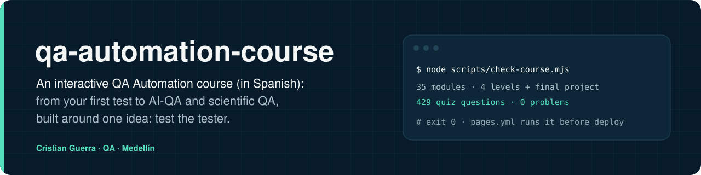
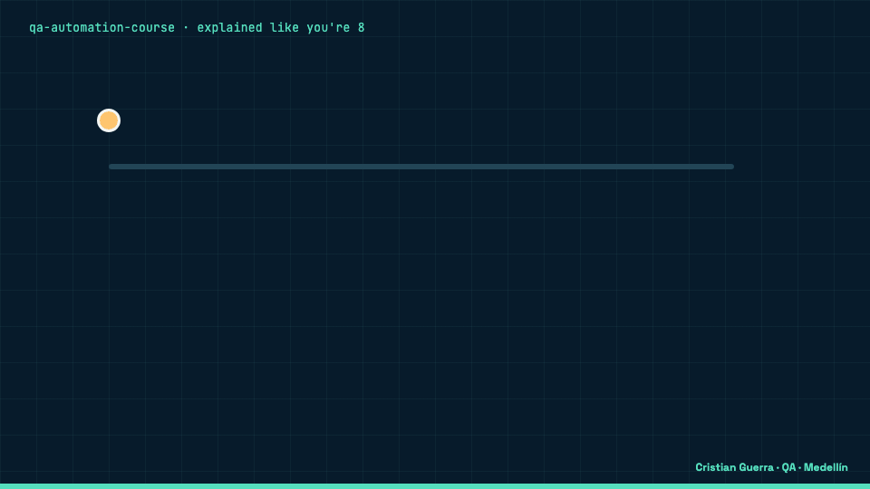
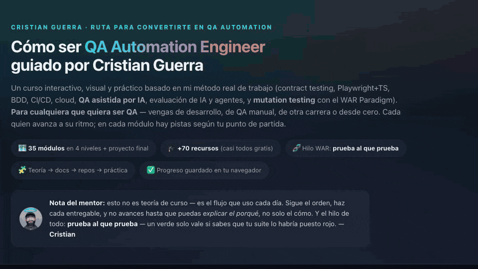
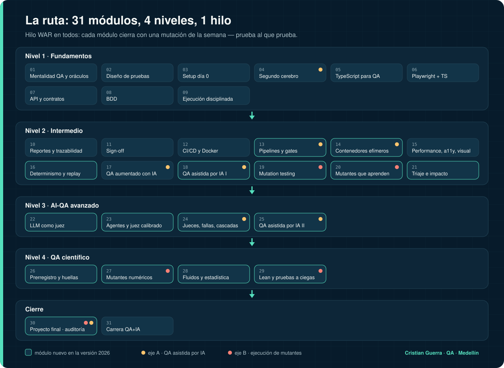
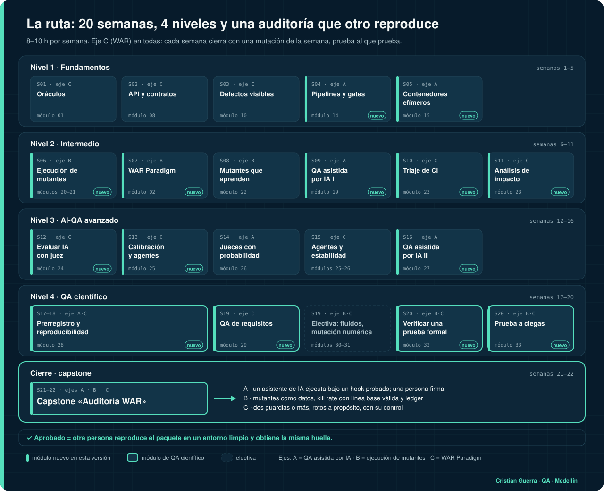

[Leer en español](README.es.md)



> **Course content in Spanish.** The site, the modules, the quizzes and the glossary are written in Spanish (Colombia). This README is in English so you can decide whether it is for you.

## Explained like you're 8

This is a course that teaches people how to check that computer programs work. It is a road with four stops, from the basics to checking robots that write answers. At every stop there is a short quiz that grades itself and a task with a list of "I did it if…". The big idea is like checking that a guard is awake: you make a noise on purpose and see if the guard shouts. If it stays quiet, the guard was asleep, and that is what you write down.

**A real example from this repo**

- **Imagine** the course has 429 quiz questions, and each one says which answer is the right one.
- **What happens:** we broke one question on purpose. It has 4 answers, and we said the right one was number 9, which does not exist.
- **What the project does:** a checking robot, `scripts/check-course.mjs`, reads every question. It found the broken one, said "1 problem" and stopped with exit code 1. The Pages workflow runs that robot before publishing, so a broken quiz does not go out.
- **What we gain:** we know the robot is awake, because we watched it catch a mistake we planted.



[MP4 version](docs/assets/explained.mp4) · source: [`docs/scenes/explained.html`](docs/scenes/explained.html)

| Hard word | What it means |
|---|---|
| Test | A question we already know the answer to, used to check that a program works |
| Quiz | A short exam inside the course that grades itself as you answer |
| Rubric | A table that says what "not yet", "almost", "passed" and "excellent" look like |
| Mutant | A copy of a program with one thing broken on purpose, to see if the tests notice |
| Pipeline (CI) | A robot that runs all the checks every time someone hands in a change |
| localStorage | A little box inside your browser where the course remembers your progress |

<p>
  
  
  
  
  
  
</p>

## What it is

A free, interactive course that takes you from QA basics to the work I do today: QA assisted by AI with a person who signs off, mutant execution, evaluating LLMs and agents, pipelines and ephemeral containers, and scientific QA (preregistration, fingerprints, reproducibility). It is one static page with no build and no backend. It has 35 modules in four levels (basics, intermediate, advanced AI-QA and scientific QA) plus a final project. The thread through all of it is the WAR Paradigm: **test the tester, mutate reality**. Every module ends with a "mutation of the week", where you break your own check on purpose and show that it notices.

## How it works


Every module has the same parts:

- **Goals** ("when you finish, you can…") and **prerequisites**.
- **Short theory and a lab.** In the new modules the lab is one of my public repos.
- **A self-graded quiz:** 8 random questions from the module's bank, one answer each, with the reason shown after every answer. You pass with 6 of 8. Each retry draws other questions.
- **A challenge with pass criteria you can verify** with a command or a screenshot, for example "your suite kills at least 5 of 6 mutants and the JSON report carries hashes" or "your judge has a kappa ≥ 0.6 against your labels".
- **A 4-level rubric** (does not meet · on the way · passed · outstanding). The newest modules use a rubric with four rows, one per skill, and passing means every row at level 3.
- **An "explained like you're 8" line** and the **mutation of the week**.

A module counts as passed with the quiz at 6/8 or more and the challenge at rubric level 3. The final exam has 26 questions and needs 80 %. The capstone, a WAR audit of a real system, has an integrated rubric across the three axes, and it only passes when another person reproduces your package in a clean environment and gets the same fingerprint. The full rules are on the [How you are graded](evaluacion.html) page (in Spanish).

A real run of the site, recorded with Playwright: open a module, answer one question right and one wrong, finish the quiz, mark the deliverable and see the node turn green on the map.



[MP4 version](docs/assets/course-run.mp4) · recorded with [`docs/scenes/record-course.mjs`](docs/scenes/record-course.mjs)

## The route



Module titles are in Spanish, as in the course. Labs link to public repos.

| # | Level | Module | Lab repos |
|---|---|---|---|
| 01 | Nivel 1 · Fundamentos | Mentalidad QA — de Dev a Tester | [war-paradigm](https://github.com/criguex/war-paradigm) |
| 02 |  | WAR Paradigm — probar al que prueba, mutar la realidad | [war-paradigm](https://github.com/criguex/war-paradigm), [scientific-qa-evidence](https://github.com/criguex/scientific-qa-evidence) |
| 03 |  | Diseño de pruebas & técnicas | — |
| 04 |  | Setup día 0 — el entorno | — |
| 05 |  | Obsidian — tu segundo cerebro (Fase 0 del método) | — |
| 06 |  | TypeScript para QA | — |
| 07 |  | Playwright + TypeScript E2E — framework desde cero | — |
| 08 |  | API & Contract Testing — tu especialidad futura | [restful-booker-quality-suite](https://github.com/criguex/restful-booker-quality-suite), [civica-playwright-challenge](https://github.com/criguex/civica-playwright-challenge) |
| 09 |  | BDD — Gherkin, Cucumber & Serenity | — |
| 10 |  | Ejecución disciplinada — ciclos, test data & known issues | — |
| 11 | Nivel 2 · Intermedio | Reportes & Trazabilidad — evidencia que se puede firmar | — |
| 12 |  | Sign-off / Certificación de una historia — el cierre del método | — |
| 13 |  | CI/CD & Docker | — |
| 14 |  | Pipelines — anatomía, gates, qué significa un verde y pipelines de evidencia | [civica-playwright-challenge](https://github.com/criguex/civica-playwright-challenge), [qa-eval-lab](https://github.com/criguex/qa-eval-lab), [restful-booker-quality-suite](https://github.com/criguex/restful-booker-quality-suite), [predictor-debugger](https://github.com/criguex/predictor-debugger) |
| 15 |  | Contenedores efímeros y entornos desechables — que la evidencia sobreviva al entorno | [predictor-debugger](https://github.com/criguex/predictor-debugger) |
| 16 |  | Performance & Cloud (K6 · JMeter · AWS) | — |
| 17 |  | Determinismo — mocks, record/replay y fixtures indexados por hash | [playwright-jev](https://github.com/criguex/playwright-jev), [civica-playwright-challenge](https://github.com/criguex/civica-playwright-challenge) |
| 18 |  | QA Aumentado con IA — mi diferenciador | — |
| 19 |  | QA asistida por IA I — el asistente prueba, la persona firma | [war-paradigm](https://github.com/criguex/war-paradigm) |
| 20 |  | Mutation testing — kill rate, sobrevivientes y Stryker/PIT | [war-paradigm](https://github.com/criguex/war-paradigm), [scientific-qa-evidence](https://github.com/criguex/scientific-qa-evidence) |
| 21 |  | Ejecución de mutantes — generar, correr, clasificar y aprender de cada corrida | [war-paradigm](https://github.com/criguex/war-paradigm), [civica-playwright-challenge](https://github.com/criguex/civica-playwright-challenge) |
| 22 |  | Mutantes que aprenden — ledger, priorización y mutantes que miden al auditor | [civica-playwright-challenge](https://github.com/criguex/civica-playwright-challenge) |
| 23 |  | Triaje de fallos de CI y selección de pruebas por impacto | [jev-ci-triage](https://github.com/criguex/jev-ci-triage), [jev-test-impact](https://github.com/criguex/jev-test-impact) |
| 24 | Nivel 3 · AI-QA avanzado | Evaluar IA con un LLM como juez — DeepEval, Promptfoo, umbrales y falsos verdes | [qa-eval-lab](https://github.com/criguex/qa-eval-lab) |
| 25 |  | Calibrar un juez y evaluar agentes de IA — chequeos de código, kappa de Cohen y revisión humana en la zona gris | [agent-eval-jev](https://github.com/criguex/agent-eval-jev), [qa-eval-lab](https://github.com/criguex/qa-eval-lab) |
| 26 |  | Jueces con probabilidad — modos de falla, estabilidad y cascadas | [war-paradigm](https://github.com/criguex/war-paradigm), [laya-server](https://github.com/criguex/laya-server), [playwright-jev](https://github.com/criguex/playwright-jev), [jev-ci-triage](https://github.com/criguex/jev-ci-triage) |
| 27 |  | QA asistida por IA II — el asistente diseña, ejecuta y audita; una persona firma | [war-paradigm](https://github.com/criguex/war-paradigm), [scientific-qa-evidence](https://github.com/criguex/scientific-qa-evidence) |
| 28 | Nivel 4 · QA científico | Prerregistro y reproducibilidad — umbrales antes de los datos y la misma huella en otra máquina | [predictor-debugger](https://github.com/criguex/predictor-debugger) |
| 29 |  | QA de requisitos — revisar la spec antes de construir | [spec-review-case-study](https://github.com/criguex/spec-review-case-study) |
| 30 |  | Controles, arnés y mutación numérica — contrato congelado y oráculo independiente | [scientific-qa-evidence](https://github.com/criguex/scientific-qa-evidence), [war-paradigm](https://github.com/criguex/war-paradigm) |
| 31 |  | Física de fluidos y estadística para el depurador | [predictor-debugger](https://github.com/criguex/predictor-debugger) |
| 32 |  | Verificar una prueba formal sin ser matemático — recompilar, checkers independientes y enunciados mutados | [scientific-qa-evidence](https://github.com/criguex/scientific-qa-evidence) |
| 33 |  | Prueba a ciegas con compromiso por hash — que quien prueba no conozca las trampas | [predictor-debugger](https://github.com/criguex/predictor-debugger), [scientific-qa-evidence](https://github.com/criguex/scientific-qa-evidence) |
| 34 | Cierre · proyecto final | Capstone «Auditoría WAR» — una auditoría que otra persona reproduce en un entorno limpio | [war-paradigm](https://github.com/criguex/war-paradigm), [predictor-debugger](https://github.com/criguex/predictor-debugger), [scientific-qa-evidence](https://github.com/criguex/scientific-qa-evidence) |
| 35 |  | Tu carrera QA+IA — posicionamiento | — |

Three ways through it: the full route from zero (about 37 weeks at 10–12 h a week), a 20-week route if you already automate UI or API tests, and a 12-week route. The 20-week route, with the module number for each week:



The 12-week route is on the [How you are graded](evaluacion.html) page.

## Run it

```bash
git clone https://github.com/criguex/qa-automation-course.git && cd qa-automation-course
python3 -m http.server 8080        # open http://localhost:8080
node scripts/check-course.mjs      # validates every module and quiz question
```

`check-course.mjs` (Node 18+, no dependencies) checks that every module has goals, prerequisites, kid line, lab, criteria, rubric and mutation of the week, that every quiz bank has at least 8 questions, and that every answer index points to a real option. Today it prints `35 modules · 4 levels + final project` and `429 quiz questions · 0 problems`.

You can sign in with Google or enter as a guest. As a guest, your progress, your best quiz score per module and your exam score live only in your browser (`localStorage`). Signed in, they are saved in Firestore under your user id, so you continue on any device; when you sign in, what you did as a guest is merged with your account (a module counts as done if it is done in either place, and the best quiz and exam scores win).

## Sign in with Google (Firebase)

The login and the cloud progress use the Firebase web config of the `curso-qa` project, which is in `index.html` (a Firebase web API key is public by design; access is controlled by the rules below). For the published site to work, the Firebase console needs:

1. **Authentication → Sign-in method → Google** enabled.
2. **Authentication → Settings → Authorized domains:** add `criguex.github.io` (and `localhost` for local tests). Until the domain is there, the button shows a message that explains it, and guests can still use the course.
3. **Firestore rules:** the ones in [`firestore.rules`](firestore.rules), so each person can only read and write their own document `progress/{uid}`.

## Publish it with GitHub Pages

[`.github/workflows/pages.yml`](.github/workflows/pages.yml) runs `check-course.mjs` and then deploys the repository root to GitHub Pages on every push to `main`. Before the first push, set **Settings → Pages → Source: GitHub Actions**; otherwise the deploy step fails.

## What was updated (26 Oct 2026)

- **Versions checked** with `npm view`, the Node release index, Maven Central and GitHub releases: Playwright 1.64, TypeScript 7.0, Node 24 LTS, Java 25 LTS, Karate 2.1, k6 2.3. The modules now cover what changed: TypeScript 7 defaults and removed options, Karate 2 (Java 21+, new CLI), k6 2.x (removed `pause/resume/scale/status` and the `externally-controlled` executor; `k6 cloud run`), and `brew install node` installing the Current release instead of the LTS.
- **Links:** 158 links checked with `curl -L`; all answered 200 except four `doi.org` links whose publishers block bots (403 to curl, they open in a browser). Redirected links were updated to their new address.
- **New modules:** WAR Paradigm, pipelines, ephemeral containers, determinism and record/replay, AI-assisted QA I and II, mutation testing, mutant execution, mutants that learn, CI triage and test impact, LLM as a judge, judge calibration and agents, probabilistic judges, preregistration and reproducibility, requirements QA, controls and numeric mutation, fluids and statistics, formal verification, and blind tests with hash commitments.
- **A real WAR case inside the course:** a mutation found two holes in the war-paradigm push-to-main hook (`git -c` and `git --no-pager` got through). They were fixed in commit `1b01c66`, and the AI-assisted QA II lab has you reproduce the bug on `1b01c66~1`, write the test that catches it and compare it with the fix.

## Limits

- The course content is in Spanish only.
- Grading is self-assessment. Nobody checks your challenge but you; the only thing stored outside your browser is your progress, and only if you sign in.
- Most labs are my own public repos. Some of their evidence is explicitly not independent (for example, the three machines in predictor-debugger are mine, and one full recompute was run by an AI assistant under my direction); the modules say so where it applies.
- Versions and links were checked on 26 Oct 2026 and will age.

## License

Dual license. The **code** (HTML, CSS, JavaScript, scripts and scenes) is [MIT](LICENSE). The **course content** (module texts, quizzes, glossary and images) is [CC BY 4.0](LICENSE-CONTENT): you can share and adapt it, including commercially, if you credit Cristian Guerra.

## Author

**Cristian Guerra** · Senior SDET / AI-QA · Medellín, Colombia · [github.com/criguex](https://github.com/criguex)
